<p align="center">
  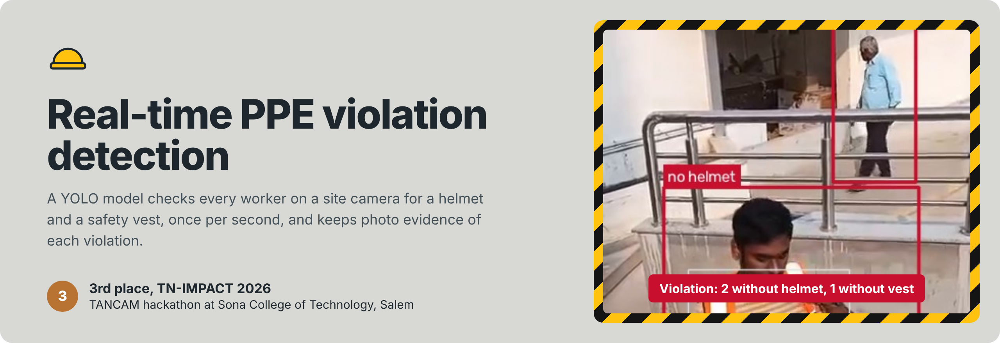
</p>

<p align="center">
  <a href="https://r-pal-aihub.github.io/Tn-Impact-Hackathon/"><b>Live demo</b></a> &nbsp;|&nbsp;
  <a href="docs/TN-IMPACT-2026-report.pdf">Project report</a> &nbsp;|&nbsp;
  <a href="docs/TN-IMPACT-2026-presentation.pdf">Slides</a> &nbsp;|&nbsp;
  <a href="https://youtu.be/gSikuVNupWM">Demo video 1</a> &nbsp;|&nbsp;
  <a href="https://youtu.be/zrvYNF5XT34">Demo video 2</a> &nbsp;|&nbsp;
  <a href="https://drive.google.com/drive/folders/1Mh6IURDg4hLgYRlpoS8jp2zb3SqvBxwS?usp=sharing">Windows build</a>
</p>

<p align="center">
  
  
  
  
  
</p>

Construction sites depend on supervisors to check that every worker wears a helmet and a safety vest. Manual checks are slow and miss things.

This project watches a site camera and checks every person in view once per second. When someone is missing a helmet or a vest, the dashboard keeps the first frame as evidence and starts a timer. If the violation lasts 15 seconds, the frame is saved as a violation report.

The team built it in 2026 for **TN-IMPACT 2026**, problem statement **TNI26154**, and won **3rd place**.

> **AI for Safety Gear Detection:** Build a computer vision model that uses site CCTV feeds to detect workers not wearing helmets or harnesses in real-time and automatically logs the safety violation.

## Contents

- [See it work](#see-it-work)
- [How it works](#how-it-works)
- [Model and results](#model-and-results)
- [Validation from the report](#validation-from-the-report)
- [Run it](#run-it)
- [Repository layout](#repository-layout)
- [Limitations and next steps](#limitations-and-next-steps)
- [Team](#team)

## See it work

<table>
<tr>
<td width="36%" valign="top">
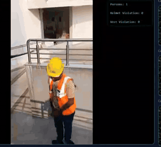
</td>
<td valign="top">

**The original app (React + FastAPI), recorded by the team**

1. The worker wears a helmet and a vest. The counts read 1 person, 0 violations.
2. He takes the helmet off. The dashboard keeps that frame in a red panel and starts a timer.
3. A second person without PPE walks in. The counts change to 2 people, 2 helmet violations, 2 vest violations.
4. After 15 seconds the browser downloads `violation_report_<date>.jpg`.

Full recordings: [demo video 1](https://youtu.be/gSikuVNupWM) (rooftop) and [demo video 2](https://youtu.be/zrvYNF5XT34) (overhead street view).

</td>
</tr>
</table>

### Try it in your browser

The [live demo](https://r-pal-aihub.github.io/Tn-Impact-Hackathon/) runs the same trained weights in your browser. You can use the sample clip, your webcam, or your own video or photo. No video leaves your device.

<a href="https://r-pal-aihub.github.io/Tn-Impact-Hackathon/">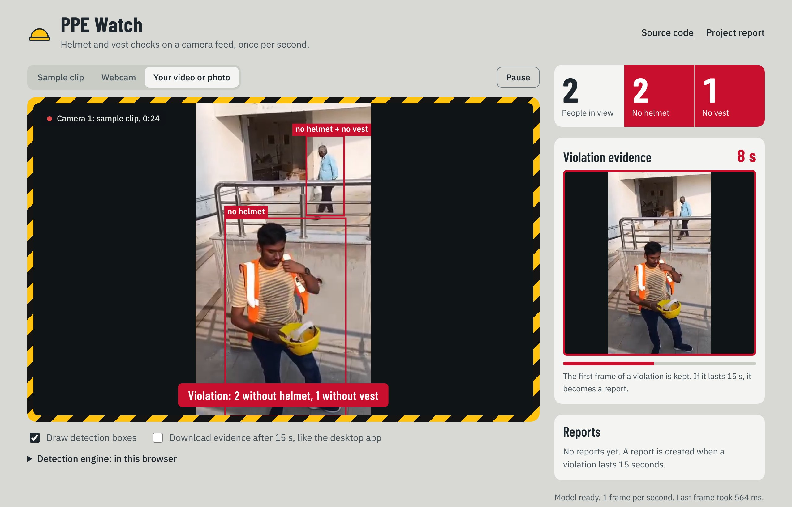</a>

The demo uses the backend's 0.20 confidence threshold and its person–PPE rules, ported line for line. It can also send frames to a running FastAPI backend instead of the browser model.

## How it works

<picture>
  <source media="(prefers-color-scheme: dark)" srcset="assets/diagrams/architecture-dark.png">
  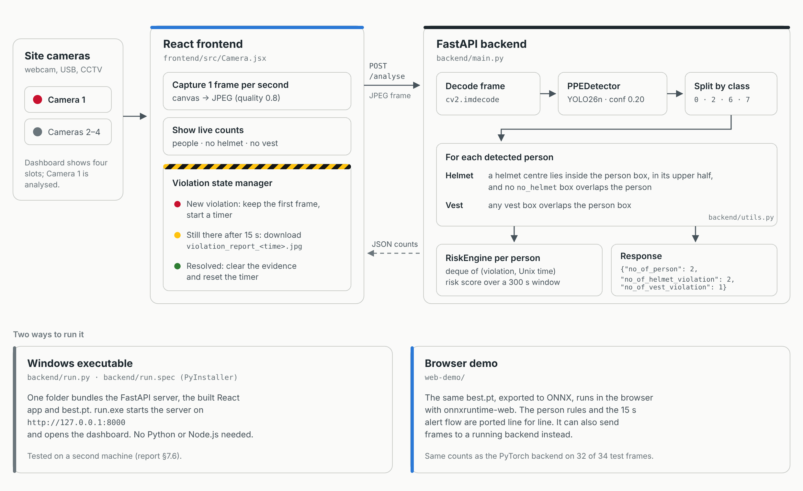
</picture>

| Step | Where | What happens |
|---|---|---|
| Capture | [`frontend/src/Camera.jsx`](frontend/src/Camera.jsx) | Draws the camera frame to a canvas once per second and posts it as a JPEG to `/analyse` |
| Detect | [`backend/detector.py`](backend/detector.py) | Runs the trained YOLO model at confidence 0.20 |
| Decide | [`backend/main.py`](backend/main.py), [`backend/utils.py`](backend/utils.py) | Checks every detected person for a helmet and a vest (rules below) |
| Log | [`backend/risk_engine.py`](backend/risk_engine.py) | Stores each violation with its Unix timestamp and computes a risk score over a 300 s window |
| Alert | [`frontend/src/Camera.jsx`](frontend/src/Camera.jsx) | Shows the counts, keeps the evidence frame, and downloads a report after 15 s |

### Decision rules

The model detects 11 classes. The backend uses four: `helmet` (0), `vest` (2), `Person` (6) and `no_helmet` (7).

| Violation | Raised when |
|---|---|
| No helmet | No helmet has its centre inside the person's box **and** in the upper half of it, **or** a `no_helmet` box overlaps the person |
| No vest | No vest box overlaps the person's box |

The upper-half rule stops a helmet held in the hand, or lying on the ground, from counting as worn. The middle frame below shows this case.

<picture>
  <source media="(prefers-color-scheme: dark)" srcset="assets/detections-dark.jpg">
  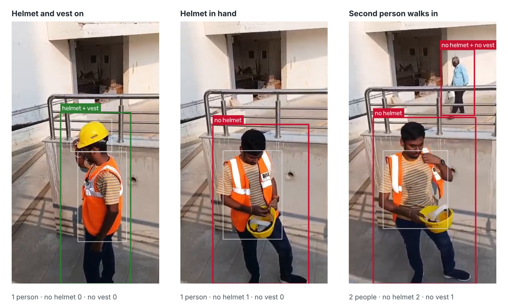
</picture>
<sub>Output of <code>backend/best.pt</code> with the backend's rules, made by <a href="scripts/make_figures.py"><code>scripts/make_figures.py</code></a>. Thin white boxes are the detected helmets and vests.</sub>

### Alert flow

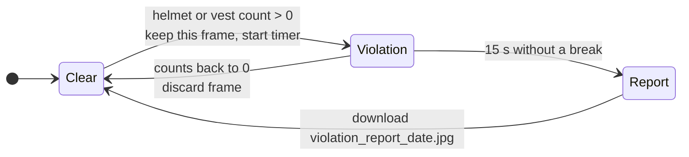

### API

```bash
curl -F "file=@frame.jpg" http://127.0.0.1:8000/analyse
```

```json
{ "no_of_person": 2, "no_of_helmet_violation": 2, "no_of_vest_violation": 1 }
```

## Model and results

| | |
|---|---|
| Model | Ultralytics YOLO26n, fine-tuned (`backend/best.pt`, 5.4 MB, 2.38 M parameters) |
| Dataset | [Ultralytics Construction-PPE](https://docs.ultralytics.com/datasets/detect/construction-ppe/): 1,132 train, 143 val, 141 test images, 11 classes |
| Training | 100 epochs, batch 8, 640 px, on an RTX 4050 laptop GPU. The kept weights are from epoch 78. |
| Details | [`training/`](training) has the notebook, arguments, per-epoch log and Ultralytics plots |

<table>
<tr>
<td width="50%">
<picture>
  <source media="(prefers-color-scheme: dark)" srcset="assets/class-ap-dark.png">
  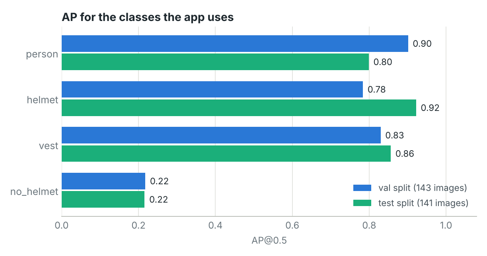
</picture>
</td>
<td width="50%">
<picture>
  <source media="(prefers-color-scheme: dark)" srcset="assets/training-dark.png">
  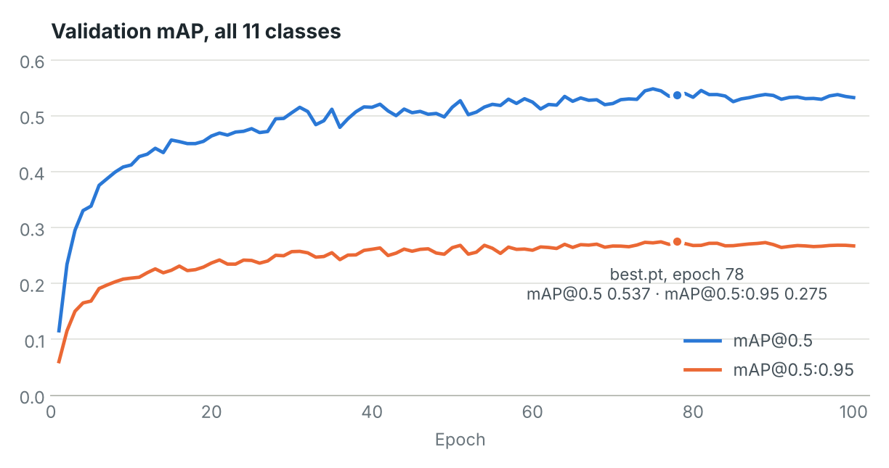
</picture>
</td>
</tr>
</table>

| Class | val AP@0.5 | test AP@0.5 | test precision | test recall |
|---|---:|---:|---:|---:|
| Person | 0.901 | 0.799 | 0.792 | 0.807 |
| helmet | 0.784 | 0.922 | 0.838 | 0.911 |
| vest | 0.830 | 0.856 | 0.780 | 0.837 |
| no_helmet | 0.218 | 0.216 | 0.371 | 0.200 |
| All 11 classes (mAP@0.5) | 0.536 | 0.507 | | |

The model finds people, helmets and vests well. It finds the explicit `no_helmet` class poorly. The backend does not depend on that class: it raises a helmet violation whenever **no helmet is found** on a person, and uses `no_helmet` only as extra evidence.

The test split was not used in training. Both columns come from `model.val()` on `best.pt` ([`training/eval_results.json`](training/eval_results.json)).

### One clip, second by second

<picture>
  <source media="(prefers-color-scheme: dark)" srcset="assets/timeline-dark.png">
  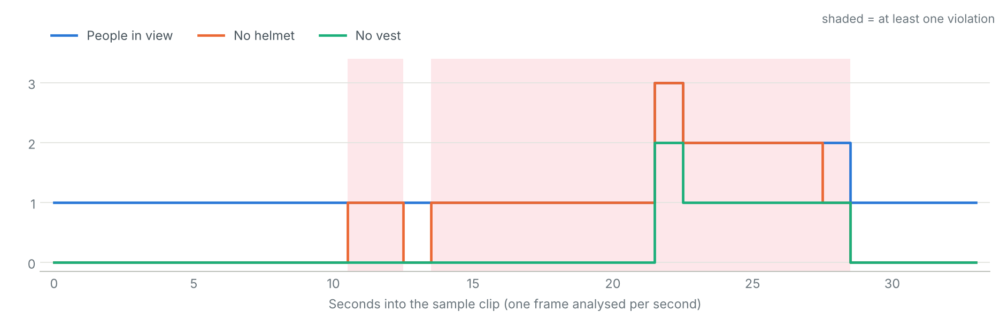
</picture>

The backend's counts at one frame per second on the [sample clip](web-demo/media/rooftop.mp4). One missed frame, as at second 13, resets the evidence timer. Smoothing over a few frames, or tracking people across frames, would prevent that.

## Validation from the report

The team tested the full app with five scenarios (report §6.1). All five gave the expected output.

| # | Scenario | Expected output | Method |
|---|---|---|---|
| 1 | One person with helmet and vest | 0 violations | Static image |
| 2 | One person without helmet | `helmet_violation = 1` | Static image |
| 3 | One person without vest | `vest_violation = 1` | Static image |
| 4 | Two people, one compliant, one not | 1 of each violation type | Multi-person image |
| 5 | Empty frame | All counts 0 | Edge case |

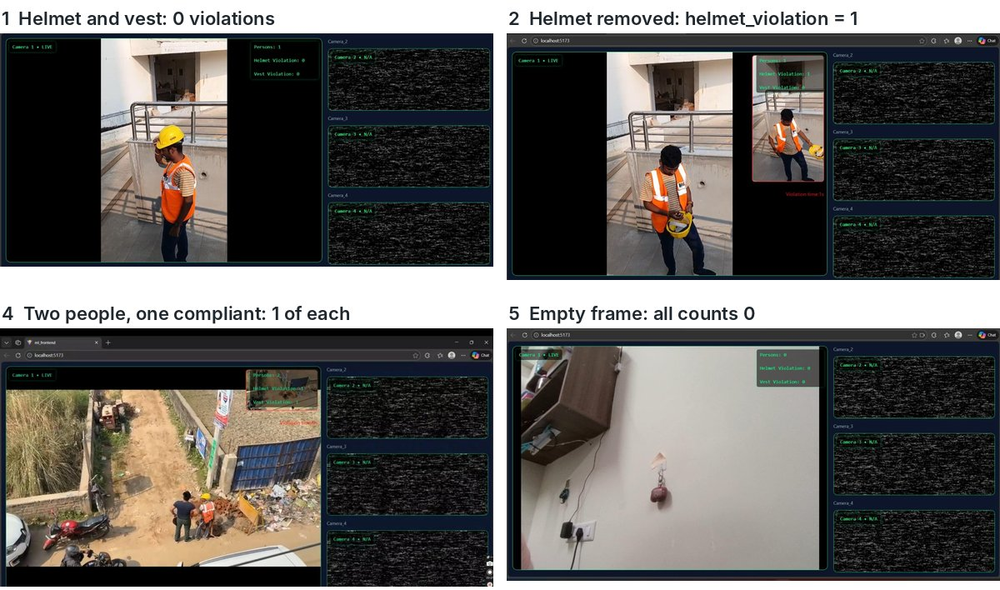

Performance measured by the team on their test device (report §6.4):

| Metric | Value | Notes |
|---|---|---|
| Average inference time | 20–60 ms | Per frame |
| First-frame inference | 120–150 ms (GPU), 360–450 ms (CPU only) | Model warm-up |
| Processing capability | 14–16 FPS | Steady state |
| Average API response | 105 ms | Includes processing |
| Input frame rate | 1 FPS | Set by the frontend |
| Model size | 5,275 KB | Trained weights file |

The packaged executable also ran on a second machine without Python or Node.js installed (report §7.6).

## Run it

### Windows executable

1. Download the ZIP from [Google Drive](https://drive.google.com/drive/folders/1Mh6IURDg4hLgYRlpoS8jp2zb3SqvBxwS?usp=sharing) and extract it.
2. Open `CONSTRUCTION-PPE-DETECTION-main` → `dist` → `run`.
3. Run `run.exe` (about 48 MB). The dashboard opens at `http://127.0.0.1:8000`.

Requirements: Windows 10 or later, 8 GB RAM, Intel i5 or equivalent. An NVIDIA RTX GPU gives the best speed.

### From source

```bash
git clone https://github.com/R-PAl-AIhub/Tn-Impact-Hackathon.git
cd Tn-Impact-Hackathon

# backend + model
pip install -r backend/requirements.txt

# dashboard, built into backend/dist
cd frontend && npm install && npm run build:backend && cd ..

# start: serves the dashboard and the API on http://127.0.0.1:8000
cd backend && python run.py
```

For frontend development, run `npm run dev` in `frontend/`. It talks to the backend on port 8000.

### Browser demo, locally

```bash
cd web-demo && python -m http.server 8080      # open http://localhost:8080
```

[`scripts/export_onnx.py`](scripts/export_onnx.py) rebuilds `web-demo/model/best.onnx` from `backend/best.pt`. On the 34 one-second frames of the sample clip, the browser model and the PyTorch backend gave the same counts on 32 frames. The two differences were detections close to the 0.20 threshold.

## Repository layout

```text
.
├── backend/          FastAPI service, detector, rules, RiskEngine, PyInstaller spec, best.pt
├── frontend/         React + Vite dashboard (the app shown in the demo videos)
├── web-demo/         Static browser demo: ONNX model, sample clip, no server needed
├── training/         Training notebook, arguments, per-epoch log, plots, evaluation
├── docs/             Project report, slides, certificate, report screenshots
├── scripts/          Figure generation, ONNX export, diagram sources
└── assets/           Images used in this README
```

The code comes from two earlier repositories, combined here:
[R-PAl-AIhub/CONSTRUCTION-PPE-DETECTION](https://github.com/R-PAl-AIhub/CONSTRUCTION-PPE-DETECTION) (backend) and
[TarunSagarSah/tn_impact_frontend](https://github.com/TarunSagarSah/tn_impact_frontend) (frontend).
The backend files here are the versions used to build the Windows executable.

## Limitations and next steps

From testing (report §6.3) and from the results above:

- **Person IDs reset every frame.** `person_0`, `person_1` are list positions, so the RiskEngine history does not follow a real person across frames. Cross-frame tracking is the planned next step.
- **Camera angle matters.** Overhead and oblique views reduce the accuracy of the upper-half helmet rule. In demo video 2, a worker seen from directly above is not detected at first.
- **Dark or unusual vests** are sometimes missed (report §7.2).
- **The risk score is not shown yet.** `RiskEngine.compute_risk_score()` and `escalation_level()` exist but the API does not return them.
- **Cameras 2–4** are placeholder tiles in the dashboard. Only Camera 1 is analysed.

Planned work (report §8): a separate identification module after the alert step, for example a face-recognition API, access-control matching, RFID badges or gate attendance logs. The report explains why identification is hard on real sites: PPE hides faces, CCTV footage is low quality, and visitors are unregistered.

## Team

**Team Data Minds**, Vellore Institute of Technology, Vellore

| Member | Programme |
|---|---|
| [Ratul Pal](https://github.com/R-PAl-AIhub) | B.Tech CSE (AI & ML) |
| [Tarun Sagar Sah](https://github.com/TarunSagarSah) | B.Tech CSE (Blockchain) |
| Dibbankur Dey | B.Tech CSE (Data Science) |

Mentor: Dr. Anindita Kundu, Assistant Professor, VIT Vellore.

### Recognition

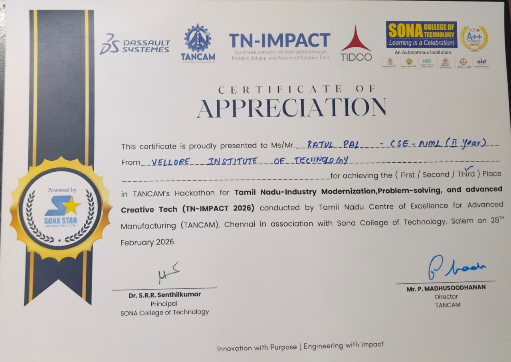

**3rd place, TN-IMPACT 2026.** TANCAM's hackathon for Tamil Nadu Industry Modernization, Problem-solving and Advanced Creative Tech. It was conducted by the Tamil Nadu Centre of Excellence for Advanced Manufacturing (TANCAM), Chennai, with Sona College of Technology, Salem, on 28 February 2026.

<br clear="right">

## Acknowledgements

[Ultralytics](https://github.com/ultralytics/ultralytics) (YOLO and the Construction-PPE dataset), [FastAPI](https://fastapi.tiangolo.com/), [OpenCV](https://opencv.org/), [React](https://react.dev/), [Vite](https://vite.dev/) and [ONNX Runtime](https://onnxruntime.ai/).

The weights were trained with Ultralytics YOLO, which is released under AGPL-3.0. See the [Ultralytics licence](https://www.ultralytics.com/license) for how it applies to trained models.
